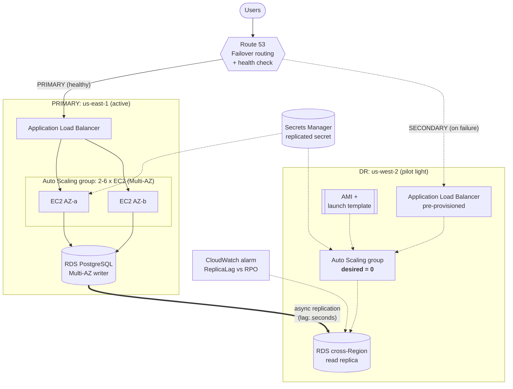
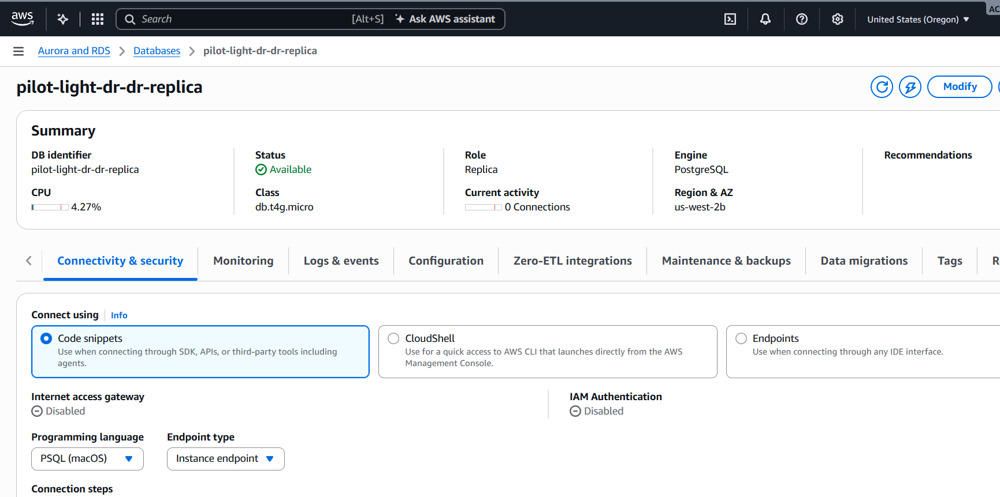
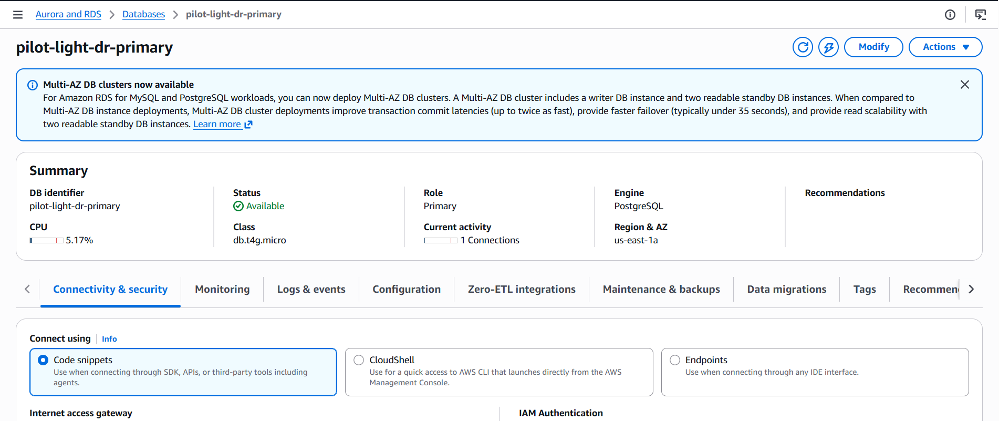
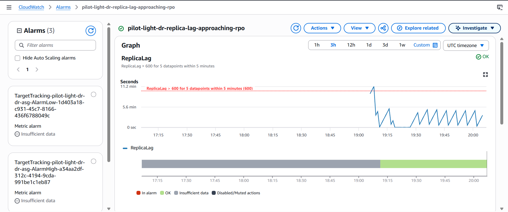
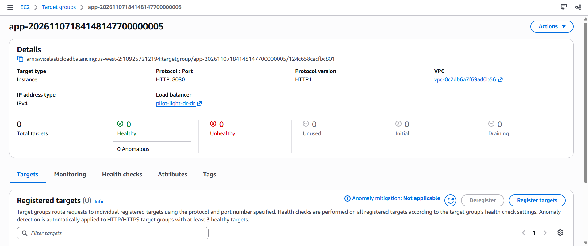

# AWS Multi-Region Disaster Recovery: Pilot Light Strategy

> **The scenario:** a production web app runs on EC2 behind an Application Load Balancer, with a Multi-AZ Auto Scaling group, Route 53 alias records and Amazon RDS for PostgreSQL. The business requires **RTO ≤ 3 hours** and **RPO ≈ 15 minutes**, at the **lowest possible cost**.
>
> **The solution:** a **Pilot Light** DR environment in a second AWS Region, built entirely with Terraform, plus scripted failover, automated RPO monitoring and repeatable DR drills.
>
> **The results (measured on a live deployment):** RPO of **0–2 seconds** under load, and the DR Region serving healthy traffic from zero servers in **69 seconds**.

    

---

## Table of contents

1. [Architecture](#architecture)
2. [Choosing the DR strategy](#choosing-the-dr-strategy)
3. [Results](#results)
4. [Screenshots](#screenshots)
5. [Repository layout](#repository-layout)
6. [Deploy it](#deploy-it)
7. [Run a DR drill](#run-a-dr-drill-safe)
8. [Runbook: failover](#runbook-failover-primary-to-dr)
9. [Runbook: failback](#runbook-failback-dr-to-primary)
10. [Cost estimate](#cost-estimate)
11. [Design decisions](#design-decisions)
12. [Troubleshooting](#troubleshooting)
13. [Clean up](#clean-up)
14. [Skills demonstrated](#skills-demonstrated)

---

## Architecture



| Layer | Primary (us-east-1) | DR (us-west-2), pilot light |
|---|---|---|
| DNS | Route 53 PRIMARY failover record + health check on `/health` | Route 53 SECONDARY failover record |
| Load balancer | ALB, active | ALB, pre-provisioned and idle |
| Compute | Auto Scaling group, 2–6 × EC2 across 2 AZs | Same launch template, **desired = 0** |
| Database | RDS PostgreSQL, **Multi-AZ** writer | **Cross-Region read replica**, continuously replicating |
| Secrets | Secrets Manager secret | Replica of the same secret |
| Monitoring | Health-check alarm | ReplicaLag alarm at ⅔ of the RPO |

**Always on in DR (the "pilot light"):** the read replica, networking, an idle ALB, the launch template and AMI, and the replicated secret.
**Off until a disaster:** all EC2 compute.

---

## Choosing the DR strategy

### Requirements

| Item | Value |
|---|---|
| RTO | **3 hours** |
| RPO | **~15 minutes** |
| Constraint | The most cost-effective option that meets both |
| Already handled | AZ failure (Multi-AZ ASG and Multi-AZ RDS). DR needs to cover **Region failure**. |

### The four AWS DR strategies compared

| Strategy | How it works | RPO | RTO | DR cost | Verdict |
|---|---|---|---|---|---|
| **Backup & Restore** | Copy snapshots and AMIs to another Region; rebuild everything with IaC during a disaster | Hours (snapshot frequency) | Hours | $ | ❌ **Fails the RPO.** Snapshots can't reliably give 15 minutes |
| **Pilot Light** | Data layer **live** (replica); compute **defined but off** | Seconds–minutes | Tens of minutes | $$ | ✅ **Meets both targets at the lowest cost** |
| **Warm Standby** | A scaled-down but **running** copy of the full stack | Seconds | Minutes | $$$ | ⚠️ Works, but pays for idle compute 24/7 to get speed nobody asked for |
| **Multi-site active/active** | Full capacity in both Regions | ~0 | ~0 | $$$$ | ❌ About double the cost, plus write-conflict complexity. Far beyond the requirements |

### Decision: Pilot Light

**The RPO is the deciding factor.** A 15-minute RPO requires continuous replication, which rules out Backup & Restore. A 3-hour RTO is generous, so there's no reason to pay for warm compute. **The data must be live, but the servers can start on demand.** That is Pilot Light.

> **Rule of thumb**
> **RPO decides how you replicate data. RTO decides how much infrastructure stays warm.**
> RPO in minutes → continuous replication → at least Pilot Light.
> RTO in hours → compute can stay cold → no need for Warm Standby.

### Consequences

- ✅ Low steady-state DR cost: no EC2 running in DR.
- ✅ The RPO is measurable through the `ReplicaLag` metric and an alarm.
- ⚠️ Failover takes a deliberate action (`scripts/failover.sh`). **Promotion is one-way**, so failback means building a new replica in reverse.
- ⚠️ Compute that is "off" can rot unnoticed (stale AMI, broken user data). Regular drills (`scripts/dr-drill.sh`) catch this.
- ⚠️ Asynchronous replication leaves a small, non-zero data-loss window, which the 15-minute RPO accepts.

### Options for the future

- **Aurora PostgreSQL Global Database:** replication lag typically under 1 s, with managed cross-Region failover. Worth considering if the targets tighten.
- **AWS Elastic Disaster Recovery (DRS):** block-level replication for EC2, if the instances ever become stateful.
- **Route 53 Application Recovery Controller:** safer, manually controlled routing switches for failover.

---

## Results

Measured on a live deployment (us-east-1 → us-west-2, 7 November 2026).

| Metric | Target | Measured | Status |
|---|---|---|---|
| **RPO, under write load** | ≤ 900 s | **0–2 s** | ✅ ~450× better than target |
| RPO, idle database (WAL-switch sawtooth) | ≤ 900 s | peaks at ~306 s | ✅ |
| RPO, initial replica sync (one-off) | ≤ 900 s | 673 s peak | ✅ |
| `check-rpo.sh` (24 h window) | PASS | max 673 s, avg 294 s | ✅ PASS |
| **DR compute ready** (`dr-drill.sh`, 0 → 1 healthy instance) | n/a | **1 min 9 s** | ✅ |
| **Estimated full RTO** | ≤ 180 min | **~8–18 min** | ✅ ~10× inside target |
| Full failover (`failover.sh`, destructive) | ≤ 180 min | _not run: the non-destructive drill was used instead_ | |
| DR steady-state cost | Lowest viable | ~$35/month (see [Cost estimate](#cost-estimate)) | ✅ |

### Replica lag, minute by minute (us-west-2)

```
Time (UTC+3)   ReplicaLag (s)
22:12          66     ┐
22:13          126    │  idle: lag "grows" 60 s per minute
22:14          186    │  (no new writes to replicate)
22:15          246    │
22:16          306    ┘
22:17          51     ← RDS WAL switch resets the counter
22:18          111
22:19          1      ┐
22:20          1      │  write traffic started:
22:21          1      │  each request INSERTs a row,
22:22          1      │  and lag drops to the real
22:23          0      │  replication delay
22:24          2      │
22:25          0      │
22:26          1      ┘
```

### RPO check

```
$ ./scripts/check-rpo.sh
Replica lag (24h): max=673.0s avg=294.27s  RPO target=900s
PASS: RPO met
```

### DR drill (non-destructive)

```
$ ./scripts/dr-drill.sh
Replica lag (24h): max=673.0s avg=149.79s  RPO target=900s
PASS: RPO met
[19:30:25] Scaling DR ASG to 1 instance
[19:30:29] Polling http://pilot-light-dr-dr-<id>.us-west-2.elb.amazonaws.com/health
[19:31:34] PASS: DR Region served healthy traffic in 1m 9s
{"region":"us-west-2","status":"ok"}
[19:31:35] Scaling DR ASG back to 0 (pilot light)
```

Starting from zero running servers, the DR Region booted an instance, installed the app, connected to the cross-Region replica and passed load-balancer health checks in **69 seconds**. It then returned to pilot-light mode automatically.

### RTO breakdown (estimated)

| Step | Time |
|---|---|
| Detect the outage (Route 53: 3 failed checks × 30 s) | ~1.5 min |
| Promote the read replica (runs in parallel with compute) | 5–15 min |
| Scale the DR ASG and pass health checks (**measured**) | 1 min 9 s |
| **Total** (compute overlaps with promotion) | **~8–18 min**, against a 180 min target |

### Key finding: ReplicaLag can mislead on idle databases

For RDS for PostgreSQL, `ReplicaLag` measures **time since the replica last applied a change**, not how much data is waiting to be copied. On an idle database there's nothing to replicate, yet the metric climbs about 60 s per minute until RDS's periodic WAL switch (roughly every 5 minutes) resets it. The result is a sawtooth that **looks** like 5 minutes of lag even though no data is at risk.

Under real write load, lag stayed at **0–2 seconds**.

**Why it matters:** an RPO alarm on raw `ReplicaLag` can raise false alarms on quiet systems. This project alarms at 600 s, and the idle sawtooth comes within reach of that. Improvements for production:
- A **heartbeat table**: a scheduled job writes a timestamp every 30–60 s. This keeps lag representative and lets you measure true end-to-end freshness by reading that timestamp on the replica.
- Alarm on the heartbeat's age, or keep the `ReplicaLag` alarm but require a longer breach window.

---

## Screenshots

> Account IDs are blurred.

| Cross-Region read replica (us-west-2) | Primary RDS, Multi-AZ (us-east-1) |
|---|---|
|  |  |

| RPO evidence: ReplicaLag under load | Pilot light: DR ASG at 0 instances |
|---|---|
|  |  |


---

## Repository layout

```
aws-pilot-light-dr/
├── README.md
├── .gitignore
├── .github/workflows/terraform.yml   # fmt, validate, tflint, trivy, shellcheck, ruff
├── app/
│   ├── app.py                        # Flask app that shows which Region served you
│   └── requirements.txt
├── scripts/
│   ├── failover.sh                   # promote replica, scale ASG, measure RTO
│   ├── dr-drill.sh                   # non-destructive DR drill
│   └── check-rpo.sh                  # 24 h replica lag vs RPO target
├── docs/screenshots/                 # images used in this README
└── terraform/
    ├── versions.tf                   # two aliased providers: primary + dr
    ├── variables.tf
    ├── main.tf                       # network + compute in both Regions, AMI copy
    ├── database.tf                   # Multi-AZ primary + cross-Region read replica
    ├── dns.tf                        # Route 53 health check + failover records
    ├── monitoring.tf                 # RPO alarm, health-check alarm, SNS
    ├── outputs.tf
    ├── terraform.tfvars.example
    └── modules/
        ├── network/main.tf           # VPC, public/private subnets, DB subnet group
        └── compute/
            ├── main.tf               # ALB, target group, IAM, launch template, ASG
            └── user_data.sh.tftpl    # boot script that installs and runs the app
```

### The demo app

| Endpoint | Purpose |
|---|---|
| `GET /` | Records a visit and returns the Region and AZ that served it. **Makes failover visible**: the Region changes after DR. |
| `GET /health` | 200 if the database is reachable, 503 if not. Used by the ALB target group and the Route 53 health check. |
| `GET /latest` | The newest write's timestamp. After a failover, compare it with when the outage started to measure the **actual RPO**. |

---

## Deploy it

**Prerequisites:** an AWS account, Terraform ≥ 1.6, AWS CLI v2 (configured with `aws configure`). Route 53 failover is optional and needs a domain in a hosted zone.

```bash
cd terraform
cp terraform.tfvars.example terraform.tfvars   # edit as needed
terraform init
terraform validate
terraform apply                                # ~20-30 min (RDS + cross-Region replica)
```

Wait 3–5 minutes after `apply` finishes for the instances to install the app, then:

```bash
curl "$(terraform output -raw primary_alb_url)"
# {"served_by_region":"us-east-1","availability_zone":"us-east-1a","total_visits":1}
```

Optional settings in `terraform.tfvars`:

| Variable | Purpose |
|---|---|
| `domain_name`, `hosted_zone_id` | Turn on Route 53 failover routing and the health check |
| `alert_email` | Receive the RPO and health-check alarms by email |
| `golden_ami_id` | Use a pre-built AMI (copied to DR automatically) instead of installing at boot |
| `dr_active` | `false` = pilot light; set to `true` after a failover |

---

## Run a DR drill (safe)

The drill **doesn't promote the database**. It proves the DR Region can boot and serve, then returns it to pilot-light mode. Run it monthly.

```bash
cd aws-pilot-light-dr                                   # project root
chmod +x scripts/*.sh
eval "$(terraform -chdir=terraform output -raw script_env)"
./scripts/check-rpo.sh     # PASS if replica lag stayed under 900 s
./scripts/dr-drill.sh      # boots 1 DR instance, times it, scales back to 0
```

To see the real replication lag, generate some writes (each request inserts a row):

```bash
for i in $(seq 1 300); do curl -s -o /dev/null "$(terraform -chdir=terraform output -raw primary_alb_url)/"; sleep 1; done
```

---

## Runbook: Failover (primary to DR)

| | |
|---|---|
| **Trigger** | The `pilot-light-dr-primary-endpoint-unhealthy` alarm, or the AWS Health Dashboard shows a Region-wide outage |
| **Decision maker** | Incident commander |
| **Target RTO / RPO** | 3 hours / 15 minutes (typical: under 20 min / seconds) |

### Simulating a disaster (for testing)

```bash
aws autoscaling update-auto-scaling-group --region us-east-1 \
  --auto-scaling-group-name pilot-light-dr-primary-asg --min-size 0 --desired-capacity 0
```

### Step 0: Decide (≤ 15 min)

- [ ] Confirm the outage is **Region-level**. It shouldn't be a single AZ (Multi-AZ already handles that) or an app bug (DR won't fix a bad deploy).
- [ ] Check the [AWS Health Dashboard](https://health.aws.amazon.com/health/status).
- [ ] Check the RPO: `./scripts/check-rpo.sh`
- [ ] The incident commander declares DR. **Promotion is irreversible**, so get explicit sign-off.

### Step 1: Fail over (≈ 10–20 min)

```bash
eval "$(terraform -chdir=terraform output -raw script_env)"
./scripts/failover.sh
```

The script:
1. Records the last `ReplicaLag` value, which is the data-loss window
2. Runs `aws rds promote-read-replica` and turns on 7-day automated backups
3. Scales the DR ASG to production size **in parallel** with the promotion
4. Waits for healthy targets, then prints the measured RTO

If the script fails, do the same steps by hand:

```bash
aws rds promote-read-replica --region us-west-2 \
  --db-instance-identifier pilot-light-dr-dr-replica --backup-retention-period 7
aws autoscaling update-auto-scaling-group --region us-west-2 \
  --auto-scaling-group-name pilot-light-dr-dr-asg --min-size 2 --desired-capacity 2
aws rds wait db-instance-available --region us-west-2 \
  --db-instance-identifier pilot-light-dr-dr-replica
```

### Step 2: Verify (≈ 10 min)

- [ ] `curl http://<domain>/` returns `"served_by_region": "us-west-2"`
- [ ] `curl http://<domain>/latest`: compare `latest_write` with when the outage started to get the **actual RPO**
- [ ] Writes work (each visit to `/` increases `total_visits`)
- [ ] In the Route 53 console, the SECONDARY record is serving

> If the primary still passes its health check (a partial outage), Route 53 won't move traffic. Force the switch by inverting the health check:
> `aws route53 update-health-check --health-check-id <id> --inverted`

### Step 3: Stabilize

- [ ] Turn on Multi-AZ for the promoted database:
      `aws rds modify-db-instance --region us-west-2 --db-instance-identifier pilot-light-dr-dr-replica --multi-az --apply-immediately`
- [ ] Set `dr_active = true` in `terraform.tfvars` and run `terraform apply`, so Terraform doesn't scale DR back to 0
- [ ] Send a status update and record the timings for the post-incident review

### Step 4: Record

| Event | Time (UTC) |
|---|---|
| Outage detected | |
| DR declared | |
| Promotion started | |
| Database available | |
| First healthy target | |
| Traffic confirmed in DR | |
| **RTO** (detected → confirmed) | |
| **RPO** (outage start − `latest_write`) | |

---

## Runbook: Failback (DR to primary)

Failback is **planned work, not an emergency**, so schedule a maintenance window. The promoted DR database is now the source of truth, which means replication has to run the other way.

### Step 1: Rebuild replication in reverse

```bash
aws rds create-db-instance-read-replica --region us-east-1 \
  --db-instance-identifier pilot-light-dr-primary-new \
  --source-db-instance-identifier arn:aws:rds:us-west-2:<account-id>:db:pilot-light-dr-dr-replica \
  --db-subnet-group-name pilot-light-dr-primary-db \
  --kms-key-id alias/aws/rds
```

- [ ] Wait until `ReplicaLag` is close to 0

### Step 2: Switch over (maintenance window, ~15–30 min without writes)

- [ ] Stop writes: scale the DR ASG to 0 or put the app into maintenance mode
- [ ] Confirm `ReplicaLag = 0`
- [ ] Promote `pilot-light-dr-primary-new`
- [ ] Point the primary launch template at the new endpoint (update `aws_db_instance.primary` in Terraform, or import the new instance into state)
- [ ] Scale the primary ASG back to production size
- [ ] Confirm the Route 53 health check passes and traffic returns to PRIMARY

### Step 3: Re-arm the pilot light

- [ ] Snapshot, then delete, the old DR database
- [ ] Set `dr_active = false` and run `terraform apply`. This recreates the cross-Region replica and returns the DR ASG to 0
- [ ] Run `./scripts/dr-drill.sh` to confirm DR is ready again

---

## Cost estimate

> These are approximate on-demand list prices in US Regions. Check the [AWS Pricing Calculator](https://calculator.aws/) before quoting figures.

### DR Region, steady state

| Item | Pilot Light (this project) | Warm Standby (comparison) |
|---|---|---|
| RDS read replica (db.t4g.micro, Single-AZ, 20 GB) | ~$15 | ~$15 |
| EC2 app instances | **$0** (ASG = 0) | ~$15 (2 × t3.micro, always on) |
| Application Load Balancer (idle) | ~$17 | ~$17 |
| Cross-Region replication data transfer | ~$0.02 per GB changed | same |
| Secrets Manager replica, KMS key, CloudWatch alarm | ~$2 | ~$2 |
| **Total (approx.)** | **~$35/month** | **~$50+/month** |

At production instance sizes (for example 4 × `m6i.large`), Warm Standby costs **hundreds of dollars more each month**. That gap is what makes Pilot Light the cost-effective choice for a 3-hour RTO.

**The whole demo running (both Regions):** roughly **$3–4 a day**, so destroy it when you're finished.

### Cutting costs further

- **Drop the idle DR ALB** (~$17/month) and create it during failover instead. The trade-off is a slightly longer RTO and a DNS change on the critical path.
- **Use Graviton instances** (`t4g`, `m7g`) in both Regions.
- **Keep Multi-AZ off on the replica** (already done here) and only turn it on after promotion.

### Production hardening (adds cost)

- Move app instances into private subnets behind NAT gateways or VPC endpoints (NAT costs ~$32/month per AZ)
- Add an HTTPS listener with an ACM certificate in each Region
- Put AWS WAF in front of both ALBs
- Set `deletion_protection = true` on the databases
- Use AWS Backup with cross-Region copies as a second line of defence. Replication faithfully copies logical corruption, such as a bad `DELETE`, and backups protect against it.

---

## Design decisions

- **A cross-Region read replica, not snapshot copies:** asynchronous replication keeps the RPO in seconds. Snapshot copies run every few hours at best.
- **A pre-provisioned ALB in DR:** it costs a little each month, but takes ALB creation and DNS changes off the critical path because Route 53 already points at it.
- **The promoted replica keeps its endpoint:** DR instances are configured with the replica's address ahead of time, so no configuration changes are needed during failover.
- **A Secrets Manager replica secret:** the credentials exist in the DR Region even if the primary Region's control plane is down.
- **Compute and database promotion run in parallel:** `failover.sh` scales the ASG while RDS promotes, which shortens the RTO.
- **An alarm at ⅔ of the RPO:** you're warned before the RPO is breached, and `treat_missing_data = breaching` catches broken replication.
- **`ignore_changes = [replicate_source_db]`:** Terraform doesn't fight the promoted database after a failover.
- **IMDSv2 only, SSM Session Manager instead of SSH, least-privilege IAM:** instances can only read their own secret.
- **Terraform state belongs in the DR Region:** use an S3 backend there or replicated there. You can't run Terraform during a disaster if your state lives in the Region that failed.

---

## Troubleshooting

| Symptom | Cause | Fix |
|---|---|---|
| `terraform init`: `Unreadable module directory ... lstat modules` | `modules/` is missing, or isn't inside `terraform/` | Make sure `terraform/modules/network/` and `terraform/modules/compute/` exist, then `rm -rf .terraform && terraform init` |
| `terraform plan`: `no file exists at ../app/app.py` | `app/` is in the wrong place | `app/` must sit **next to** `terraform/`, not inside it |
| `502` / `503` from the ALB just after `apply` | Instances are still installing the app | Wait 3–5 minutes |
| `TargetTracking-...-AlarmLow` shows "In alarm" | Normal. CPU is idle, but the ASG minimum of 2 stops it scaling in | Nothing to do |
| `check-rpo.sh`: "no ReplicaLag data" | CloudWatch hasn't collected any data yet | Wait 10–15 minutes after deploying |
| `ReplicaLag` goes up and down to ~300 s | The idle-database sawtooth (see [Key finding](#key-finding-replicalag-can-mislead-on-idle-databases)) | Generate writes. Lag falls to 0–2 s |

---

## Clean up

```bash
cd terraform && terraform destroy
```

If you ran `failover.sh`, the promoted database is no longer a replica, but `terraform destroy` still deletes it.

---

## Skills demonstrated

Multi-Region architecture · Disaster recovery (RTO/RPO) · Terraform modules and multi-provider configuration · RDS cross-Region replication · Route 53 failover routing · Auto Scaling · IAM least privilege · Secrets Manager · CloudWatch alarms · Bash automation · CI/CD (GitHub Actions) · Operational runbooks · Cost optimisation